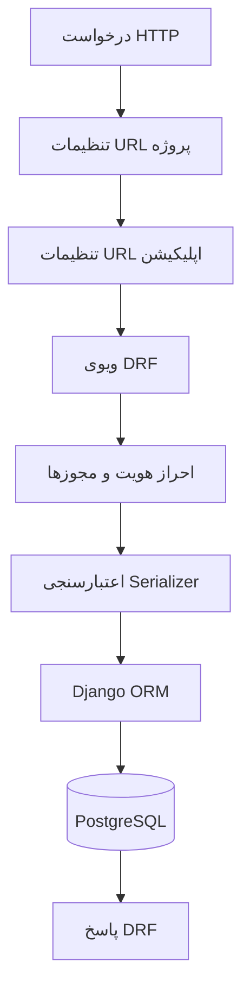
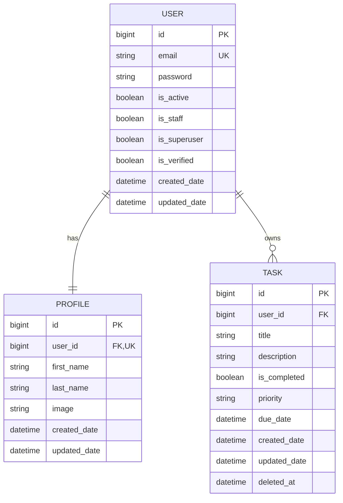
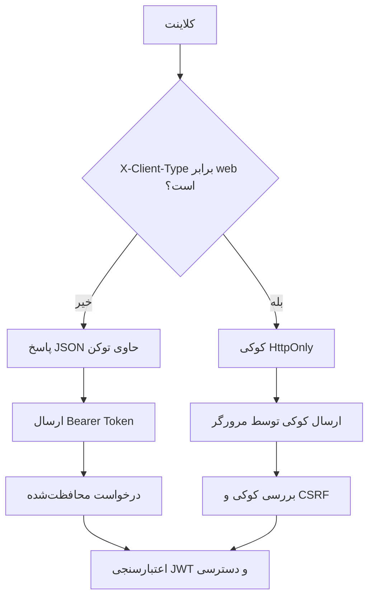

# Todo-App-DRF

یک پروژهٔ مدیریت وظایف با API معماری RESTful و رابط وب واکنش‌گرا که با
**Django** و **Django REST Framework** توسعه داده شده است. پروژه علاوه بر
عملیات CRUD، موضوعاتی مانند مدیریت حساب کاربری، احراز هویت JWT، مالکیت
داده‌ها، اعتبارسنجی، مدیریت چرخه عمر توکن‌ها، عملیات گروهی اتمیک، حذف نرم
و تست خودکار API را پوشش می‌دهد.

## فهرست مطالب

-   [معرفی پروژه](#معرفی-پروژه)
-   [قابلیت‌ها](#قابلیت‌ها)
-   [فناوری‌های استفاده‌شده](#فناوریهای-استفادهشده)
-   [ساختار پروژه](#ساختار-پروژه)
-   [مدل‌های داده](#مدلهای-داده)
-   [طراحی احراز هویت](#طراحی-احراز-هویت)
-   [مرجع API](#مرجع-api)
-   [رابط کاربری وب](#رابط-کاربری-وب)
-   [جست‌وجو و فیلتر وظایف](#جستوجو-و-فیلتر-وظایف)
-   [امنیت و اعتبارسنجی](#امنیت-و-اعتبارسنجی)
-   [تست‌ها](#تستها)
-   [راه‌اندازی با Docker Compose](#راهاندازی-با-docker-compose)
-   [مستندات API](#مستندات-api)
-   [تصمیم‌های فنی](#تصمیمهای-فنی)

## معرفی پروژه

Todo-App-DRF یک API نسخه‌بندی‌شده برای مدیریت وظایف شخصی کاربران است. هر
وظیفه به یک کاربر تعلق دارد و کاربران فقط می‌توانند وظایف مربوط به حساب
خود را مشاهده یا مدیریت کنند. امکاناتی مانند ایجاد، دریافت، ویرایش،
تکمیل و حذف نرم وظایف، عملیات گروهی و دریافت آمار در API فراهم شده است.

در بخش حساب‌های کاربری از مدل کاربر سفارشی با ایمیل به‌عنوان شناسه ورود و
یک مدل جداگانه برای پروفایل استفاده شده است. احراز هویت با Simple JWT
انجام می‌شود و امکانات ثبت‌نام، ورود، تمدید و بررسی توکن، خروج، تغییر رمز
عبور، مدیریت پروفایل و حذف حساب را در بر می‌گیرد.

علاوه بر API، یک رابط وب فارسی و واکنش‌گرا با قالب‌های Django و jQuery
نیز ارائه می‌شود. این رابط برای ورود و ثبت‌نام، مدیریت کارها، مشاهده
آمار، مدیریت پروفایل و تغییر رمز عبور از همان APIها استفاده می‌کند.

محیط توسعه پروژه با Docker Compose اجرا می‌شود و از PostgreSQL و smtp4dev
نیز استفاده می‌کند.

## قابلیت‌ها

### مدیریت حساب‌های کاربری

-   مدل کاربر سفارشی با ایمیل یکتا به‌عنوان شناسه ورود.
-   مدل پروفایل جداگانه با رابطه یک‌به‌یک با کاربر.
-   ثبت‌نام همراه با تأیید رمز عبور و اعتبارسنجی‌های Django.
-   ورود، تمدید توکن، بررسی اعتبار توکن و خروج با Simple JWT.
-   تحویل توکن به‌صورت JSON برای اپلیکیشن‌ها و کوکی HttpOnly برای
    مرورگرها.
-   احراز هویت درخواست‌های مرورگر از طریق کوکی و بررسی CSRF برای
    درخواست‌های تغییردهنده داده.
-   قرار دادن Refresh Token در لیست سیاه هنگام خروج.
-   ابطال تمام Refresh Tokenهای کاربر هنگام تغییر رمز عبور و حذف حساب.
-   دریافت و ویرایش پروفایل کاربر.
-   اعتبارسنجی و پردازش تصویر پروفایل برای فرمت‌های JPEG و PNG.

### مدیریت وظایف

-   ایجاد، فهرست‌کردن، دریافت جزئیات، ویرایش و حذف نرم وظایف.
-   اولویت‌های `low`، `medium` و `high`.
-   تاریخ سررسید اختیاری همراه با اعتبارسنجی.
-   جداسازی داده‌ها بر اساس مالک وظیفه.
-   تکمیل گروهی و حذف نرم گروهی.
-   اجرای عملیات گروهی به‌صورت اتمیک؛ در صورت نامعتبر بودن یکی از شناسه‌ها
    یا تعلق آن به کاربر دیگر، هیچ تغییر ناقصی اعمال نمی‌شود.
-   محاسبه آمار با تجمیع داده‌ها در پایگاه داده.
-   جست‌وجو، فیلتر، مرتب‌سازی و صفحه‌بندی.
-   فهرست تاریخچهٔ کارهای حذف‌شده با صفحه‌بندی و امکان بازگردانی کار.

### رابط کاربری وب

-   داشبورد فارسی و راست‌چین با طراحی واکنش‌گرا برای موبایل و دسکتاپ.
-   استفاده از نام و نشان `Todo App` در صفحه‌های رابط کاربری.
-   ساخت، ویرایش، تکمیل تکی و حذف نرم کارها با درخواست‌های AJAX.
-   تکمیل گروهی و حذف نرم گروهی کارهای انتخاب‌شده.
-   جست‌وجو، فیلتر وضعیت و اولویت، مرتب‌سازی و صفحه‌بندی فهرست.
-   نمایش آمار کارهای کل، تکمیل‌شده، در انتظار و عقب‌افتاده.
-   تاریخچهٔ کارهای حذف‌شده با تاریخ حذف و امکان بازگردانی.
-   صفحه‌های ورود، ثبت‌نام، پروفایل (همراه با بارگذاری تصویر) و تغییر
    رمز عبور که با endpointهای حساب کاربری یکپارچه هستند.
-   ارسال درخواست‌های مرورگر با هدر `X-Client-Type: web`، کوکی‌های
    HttpOnly و CSRF Token.
-   قالب‌ها در `core/templates/` و فایل‌های CSS و JavaScript در
    `core/staticfiles/` نگهداری می‌شوند.

### امکانات API و توسعه

-   ساختار URL نسخه‌بندی‌شده.
-   قالب پاسخ خطای سفارشی برای خطاهای اعتبارسنجی.
-   مستندات OpenAPI و رابط Swagger با drf-spectacular.
-   تست خودکار با pytest و pytest-django.
-   محیط توسعه Docker Compose.
-   مدیریت تنظیمات با python-decouple.

## فناوری‌های استفاده‌شده

  بخش            فناوری
  -------------- -------------------------------------
  زبان           Python 3.13
  فریم‌ورک        Django 6.1.1
  API            Django REST Framework 3.18.1
  احراز هویت     djangorestframework-simplejwt 5.5.1
  پایگاه داده    PostgreSQL 17
  ORM            Django ORM
  فیلتر          django-filter 26.2
  مستندات API    drf-spectacular 0.30.0
  پردازش تصویر   Pillow 12.3.0
  تنظیمات        python-decouple
  تست            pytest 9.1.1 و pytest-django 4.14.0
  رابط کاربری    Django Templates و jQuery 3.7.1
  کانتینرسازی    Docker و Docker Compose
  ایمیل توسعه    smtp4dev

نسخه‌ها بر اساس فایل‌های وابستگی و تنظیمات Compose پروژه درج شده‌اند.

## ساختار پروژه

پروژه از دو اپلیکیشن اصلی `accounts` و `todos` تشکیل شده است. هر
اپلیکیشن بخش‌های API، مسیرهای نسخه‌بندی‌شده، ویوها، سریالایزرها، ابزارهای
کمکی، مدل‌ها، تست‌ها و مهاجرت‌های خود را دارد.

``` text
Todo-App-DRF/
├── core/
│   ├── core/
│   │   ├── settings.py
│   │   └── urls.py
│   ├── templates/
│   │   ├── base.html
│   │   ├── accounts/
│   │   └── todos/
│   ├── staticfiles/
│   │   ├── css/
│   │   │   └── app.css
│   │   ├── js/
│   │   │   └── app.js
│   │   └── img/
│   │       └── profile/default.png
│   ├── apps/
│   │   ├── accounts/
│   │   │   ├── api/
│   │   │   │   ├── utils/
│   │   │   │   └── v1/
│   │   │   │       ├── serializers.py
│   │   │   │       ├── urls.py
│   │   │   │       └── views.py
│   │   │   ├── migrations/
│   │   │   ├── tests/
│   │   │   ├── models.py
│   │   │   ├── admin.py
│   │   │   ├── urls.py
│   │   │   └── views.py
│   │   └── todos/
│   │       ├── api/
│   │       │   ├── utils/
│   │       │   └── v1/
│   │       │       ├── serializers.py
│   │       │       ├── urls.py
│   │       │       └── views.py
│   │       ├── migrations/
│   │       ├── tests/
│   │       ├── models.py
│   │       ├── admin.py
│   │       ├── urls.py
│   │       └── views.py
│   ├── manage.py
│   └── media/                 # فایل‌های آپلودشده در زمان اجرا
├── dockerfiles/
│   └── dev/django/Dockerfile
├── envs/
│   └── dev/django/.env.sample
├── docs/
│   ├── database_schema.png
│   ├── PROJECT_GUIDE_FA.md
│   └── Your Project API.yaml
├── requirements.txt
├── docker-compose.yml
└── README.md
```

تنظیمات `STATICFILES_DIRS` به `core/staticfiles/` اشاره می‌کند. فایل
اصلی ظاهر رابط در `core/staticfiles/css/app.css` و کد AJAX در
`core/staticfiles/js/app.js` قرار دارد. قالب پایه `base.html` فایل‌های
استایل و اسکریپت‌ها را به همهٔ صفحه‌ها متصل می‌کند؛ jQuery 3.7.1 از CDN
بارگذاری می‌شود.

### روند پردازش درخواست



ویو درخواست و دسترسی را مدیریت می‌کند، سریالایزر داده‌های ورودی و خروجی را
اعتبارسنجی و تبدیل می‌کند و Django ORM عملیات پایگاه داده را انجام می‌دهد.

## مدل‌های داده

مدل‌های اصلی پروژه `User`، `Profile` و `Task` هستند.



### User و Profile

-   مدل `User` از `AbstractBaseUser` و `PermissionsMixin` ارث‌بری می‌کند.
-   ایمیل شناسه یکتای ورود است و از username استفاده نمی‌شود.
-   `UserManager` متدهای ساخت کاربر عادی و مدیر کل را فراهم می‌کند.
-   `Profile` رابطه یک‌به‌یک با `User` دارد.
-   با ایجاد کاربر، پروفایل متناظر از طریق سیگنال `post_save` ساخته
    می‌شود.
-   حذف کاربر باعث حذف پروفایل و وظایف متعلق به او می‌شود.

### Task

هر وظیفه از طریق ForeignKey به یک کاربر تعلق دارد و شامل عنوان، توضیحات
اختیاری، وضعیت تکمیل، اولویت، تاریخ سررسید اختیاری، زمان ایجاد و ویرایش
و فیلد nullable به نام `deleted_at` است.

برای بهبود پرس‌وجوهای متداول، ایندکس ترکیبی روی `(user, is_completed)`
تعریف شده است. حذف وظیفه به‌صورت نرم انجام می‌شود؛ مقدار `deleted_at`
تنظیم می‌شود و وظیفه از فهرست‌ها و جزئیات عادی کنار گذاشته می‌شود.

## طراحی احراز هویت

احراز هویت با Simple JWT پیاده‌سازی شده است. نوع کلاینت با هدر
`X-Client-Type` مشخص می‌شود.

  -----------------------------------------------------------------------
  نوع کلاینت              هدر                     روش دریافت توکن
  ----------------------- ----------------------- -----------------------
  اپلیکیشن مستقل          هدر ارسال نمی‌شود یا     توکن‌های Access و
                          مقدار آن `web` نیست     Refresh در پاسخ JSON

  مرورگر                  `X-Client-Type: web`    توکن‌ها در کوکی‌های
                                                  HttpOnly قرار می‌گیرند و
                                                  از پاسخ JSON حذف می‌شوند
  -----------------------------------------------------------------------

نام کوکی‌ها `access_token` و `refresh_token` است. ویژگی‌هایی مانند
`Secure`، `HttpOnly`، `SameSite`، مسیر و دامنه از طریق تنظیمات Django و
متغیرهای محیطی قابل پیکربندی هستند.

### احراز هویت درخواست‌های مرورگر

کلاس سفارشی `CookieJWTAuthentication` از هر دو روش پشتیبانی می‌کند:

-   اگر هدر `Authorization` وجود داشته باشد، توکن Bearer از آن خوانده
    می‌شود.
-   در غیر این صورت، توکن دسترسی از کوکی `access_token` خوانده می‌شود.
-   درخواست‌هایی که با کوکی احراز هویت می‌شوند، تحت بررسی CSRF قرار
    می‌گیرند.
-   درخواست‌های امن مانند `GET`، `HEAD` و `OPTIONS` به CSRF Token نیاز
    ندارند.
-   درخواست‌های تغییردهنده داده مانند `POST`، `PUT`، `PATCH` و `DELETE`
    باید CSRF معتبر ارسال کنند.

در نتیجه، endpointهای محافظت‌شده نیز می‌توانند درخواست مرورگر را با کوکی
دسترسی احراز هویت کنند؛ برخلاف رفتار کلاس پیش‌فرض `JWTAuthentication` که
توکن را از هدر Authorization می‌خواند.

### چرخه عمر توکن‌ها

-   مدت اعتبار Access Token و Refresh Token قابل تنظیم است.
-   در صورت فعال بودن چرخش Refresh Token، هنگام تمدید توکن، Refresh
    Token جدید صادر می‌شود.
-   توکن‌های Refresh با اپلیکیشن blacklist در Simple JWT قابل ابطال
    هستند.
-   هنگام خروج، Refresh Token نشست مربوطه در لیست سیاه قرار می‌گیرد.
-   هنگام تغییر رمز عبور، تمام Refresh Tokenهای ثبت‌شده برای کاربر باطل
    می‌شوند.
-   هنگام حذف حساب نیز توکن‌های Refresh کاربر باطل می‌شوند.
-   با فعال بودن `CHECK_REVOKE_TOKEN`، تغییر رمز عبور باعث نامعتبرشدن
    Access Tokenهای قبلی نیز می‌شود.

### روند کلی احراز هویت



## مرجع API

تمام مسیرهای API نسخه‌بندی شده‌اند و از پیشوند اپلیکیشن مربوطه استفاده
می‌کنند.

### حساب‌های کاربری

مسیر پایه:

``` text
/accounts/api/v1/
```

  متد              مسیر                          احراز هویت   کاربرد
  ---------------- ----------------------------- ------------ -------------------------------
  `POST`           `/register/`                  عمومی        ثبت‌نام کاربر
  `POST`           `/login/`                     عمومی        ورود و دریافت توکن
  `POST`           `/refresh-token/`             عمومی        تمدید Access Token
  `POST`           `/session/verify/`            عمومی        بررسی اعتبار توکن
  `POST`           `/logout/`                    عمومی        خروج و ابطال Refresh Token
  `GET`            `/csrf/`                      عمومی        دریافت CSRF Token برای مرورگر
  `PATCH`          `/change-password/`           لازم         تغییر رمز عبور
  `GET`            `/users/me/`                  لازم         دریافت پروفایل کاربر فعلی
  `PUT`, `PATCH`   `/users/me/`                  لازم         جایگزینی یا ویرایش پروفایل
  `DELETE`         `/users/me/delete-account/`   لازم         حذف حساب کاربر فعلی

### Tasks

مسیر پایه:

``` text
/todos/api/v1/
```

  متد              مسیر                     احراز هویت   کاربرد
  ---------------- ------------------------ ------------ ------------------------------------
  `GET`            `/tasks-list/`           لازم         فهرست وظایف فعال کاربر
  `POST`           `/tasks-list/`           لازم         ایجاد وظیفه
  `GET`            `/task/{id}/`            لازم         دریافت جزئیات وظیفه متعلق به کاربر
  `PUT`, `PATCH`   `/task/{id}/`            لازم         ویرایش وظیفه
  `DELETE`         `/task/{id}/`            لازم         حذف نرم وظیفه
  `GET`            `/task/history/`         لازم         تاریخچه صفحه‌بندی‌شده کارهای حذف‌شده کاربر
  `POST`           `/task/{id}/restore/`    لازم         بازگردانی وظیفه حذف‌شده متعلق به کاربر
  `GET`            `/task/stats/`           لازم         دریافت آمار وظایف
  `PATCH`          `/task/bulk-complete/`   لازم         تکمیل گروهی وظایف
  `DELETE`         `/task/bulk-delete/`     لازم         حذف نرم گروهی وظایف

### نمونه ایجاد Task

``` http
POST /todos/api/v1/tasks-list/
Authorization: Bearer <access-token>
Content-Type: application/json
```

``` json
{
  "title": "مرور مستندات API",
  "description": "بررسی مسیرها و پارامترهای وظایف",
  "priority": "high",
  "due_date": null
}
```

مالک وظیفه در سمت سرور و از طریق `request.user` تعیین می‌شود؛ بنابراین
کلاینت نمی‌تواند وظیفه را به کاربر دیگری اختصاص دهد.

### نمونه تکمیل گروهی

``` http
PATCH /todos/api/v1/task/bulk-complete/
Authorization: Bearer <access-token>
Content-Type: application/json
```

``` json
{
  "ids": [12, 13, 14]
}
```

شناسه‌ها از نظر خالی نبودن، مثبت بودن، تکراری نبودن و حداکثر تعداد ۱۰۰
مورد اعتبارسنجی می‌شوند. عملیات داخل `transaction.atomic()` انجام می‌شود.
اگر حتی یکی از شناسه‌ها به وظیفه فعال متعلق به کاربر فعلی اشاره نکند،
درخواست رد می‌شود و هیچ تغییر ناقصی اعمال نخواهد شد.

### تاریخچه و بازگردانی وظایف حذف‌شده

حذف تکی و گروهی وظایف نرم است و رکورد از پایگاه داده پاک نمی‌شود. زمان
حذف در `deleted_at` ثبت می‌شود؛ وظایف حذف‌شده در فهرست و آمار عادی
نمایش داده نمی‌شوند و فقط در تاریخچهٔ متعلق به همان کاربر قابل مشاهده‌اند.

دریافت تاریخچه، صفحه‌بندی استاندارد API را برمی‌گرداند:

``` http
GET /todos/api/v1/task/history/?page=1&page_size=10
X-Client-Type: web
```

برای بازگرداندن یک وظیفه به فهرست فعال:

``` http
POST /todos/api/v1/task/12/restore/
X-Client-Type: web
X-CSRFToken: <csrf-token>
```

هر دو endpoint نیازمند احراز هویت هستند. QuerySet تاریخچه و بازگردانی
بر اساس کاربر جاری محدود شده است؛ بنابراین کاربر نمی‌تواند وظیفهٔ حذف‌شدهٔ
کاربر دیگری را مشاهده یا بازگردانی کند.

## رابط کاربری وب

رابط وب با Django Templates رندر می‌شود و برای عملیات حساب و وظایف، با
jQuery و AJAX به APIهای نسخهٔ ۱ درخواست می‌فرستد. صفحه‌ها فارسی، راست‌چین
و واکنش‌گرا هستند.

### صفحه‌ها

  صفحه                 مسیر                         قابلیت
  -------------------- ---------------------------- ------------------------------------
  داشبورد وظایف        `/todos/`                    فهرست، جست‌وجو، فیلتر، مرتب‌سازی و آمار
  ورود                 `/accounts/login/`           ورود با ایمیل و رمز عبور
  ثبت‌نام              `/accounts/registration/`    ساخت حساب با تأیید رمز عبور
  پروفایل              `/accounts/user-profile/`    ویرایش نام، نام خانوادگی و تصویر
  تغییر رمز عبور       `/accounts/change-password/` تغییر رمز عبور حساب واردشده

### رفتار داشبورد

-   کار جدید از طریق `POST /todos/api/v1/tasks-list/` ساخته می‌شود؛
    ویرایش، تکمیل و حذف تکی از endpoint جزئیات وظیفه استفاده می‌کنند.
-   چک‌باکس هر ردیف امکان انتخاب چند کار را فراهم می‌کند. دکمهٔ تکمیل
    انتخاب‌شده‌ها از `PATCH /task/bulk-complete/` و دکمهٔ حذف
    انتخاب‌شده‌ها از `DELETE /task/bulk-delete/` استفاده می‌کنند.
-   پنل «تاریخچهٔ حذف‌شده‌ها» فهرست صفحه‌بندی‌شدهٔ
    `GET /task/history/` را نمایش می‌دهد. دکمهٔ «بازگردانی» در هر ردیف
    `POST /task/{id}/restore/` را فراخوانی می‌کند.
-   جست‌وجو، فیلتر وضعیت و اولویت، مرتب‌سازی و صفحه‌بندی از پارامترهای
    API فهرست وظایف استفاده می‌کنند.
-   آمار داشبورد از `GET /task/stats/` و اطلاعات حساب از
    `GET /accounts/api/v1/users/me/` خوانده می‌شود.
-   فرم پروفایل با `PATCH /accounts/api/v1/users/me/` و ارسال
    `multipart/form-data` امکان بارگذاری تصویر را دارد.
-   تغییر رمز با `PATCH /accounts/api/v1/change-password/` انجام
    می‌شود. در صورت موفقیت، نشست مرورگر باطل و کاربر به صفحهٔ ورود
    هدایت می‌شود.

### فایل‌های قالب و استاتیک

-   `core/templates/base.html`: قالب پایه، راست‌چین و پیوند فایل‌های CSS
    و JavaScript.
-   `core/templates/todos/index.html`: داشبورد، فهرست فعال و تاریخچهٔ
    حذف‌شده‌ها.
-   `core/templates/accounts/`: قالب‌های ورود، ثبت‌نام، پروفایل و تغییر
    رمز عبور.
-   `core/staticfiles/css/app.css`: ظاهر واکنش‌گرا، کارت‌ها، فرم‌ها،
    پنجرهٔ ایجاد/ویرایش و چیدمان تاریخچه؛ عنوان و جزئیات هر کار از دکمهٔ
    بازگردانی جدا و خوانا باقی می‌مانند.
-   `core/staticfiles/js/app.js`: ارتباط AJAX با API، مدیریت CSRF،
    خطاها، صفحه‌بندی و تعاملات رابط.
-   مسیر تصاویر استاتیک `/static/` و مسیر فایل‌های آپلودشده `/media/`
    است. تصویر پروفایل در `MEDIA_ROOT` ذخیره می‌شود؛ تصاویر ثابت در
    `core/staticfiles/` قرار می‌گیرند.

درخواست‌های مرورگر هدر `X-Client-Type: web` را ارسال می‌کنند. کد
JavaScript ابتدا از `/accounts/api/v1/csrf/`، CSRF Token می‌گیرد و برای
درخواست‌های تغییردهنده داده آن را در `X-CSRFToken` می‌فرستد. توکن‌های JWT
در کوکی‌های HttpOnly باقی می‌مانند و در دسترس JavaScript نیستند.

## جست‌وجو و فیلتر وظایف

  -----------------------------------------------------------------------
  قابلیت                  پارامتر                 توضیح
  ----------------------- ----------------------- -----------------------
  جست‌وجو                  `search`                جست‌وجو در عنوان و
                                                  توضیحات

  وضعیت                   `is_completed`          مقدار بولی

  اولویت                  `priority`              `low`، `medium`، `high`

  بازه تاریخ سررسید       `due_date_after` و      فیلتر بازه زمانی
                          `due_date_before`       

  مرتب‌سازی                `ordering`              `created_date`،
                                                  `updated_date`،
                                                  `due_date`، `priority`،
                                                  `title`

  صفحه‌بندی                `page`                  شماره صفحه

  اندازه صفحه             `page_size`             حداکثر ۱۰۰ مورد
  -----------------------------------------------------------------------

برای مرتب‌سازی نزولی، قبل از نام فیلد از `-` استفاده کنید:

``` text
/todos/api/v1/tasks-list/?ordering=-created_date
```

مقادیر نامعتبر فیلترها و فیلدهای مرتب‌سازی پشتیبانی‌نشده با خطای
اعتبارسنجی پاسخ داده می‌شوند.

پاسخ صفحه‌بندی شامل `results`، `page`، `page_size`، `total`، `pages` و
لینک‌های `links.next` و `links.previous` است.

مسیر آمار وظایف، تعداد کل، تکمیل‌شده، در انتظار و عقب‌افتاده را برای کاربر
فعلی محاسبه می‌کند و وظایف حذف‌شده را در نظر نمی‌گیرد.

## امنیت و اعتبارسنجی

-   QuerySet وظایف بر اساس `request.user` محدود می‌شود تا کاربران به
    وظایف یکدیگر دسترسی نداشته باشند.
-   مالک وظیفه هنگام ایجاد در سمت سرور تعیین می‌شود.
-   تاریخ سررسید گذشته پذیرفته نمی‌شود.
-   پیش از اجرای عملیات گروهی، مالکیت تمام وظایف بررسی می‌شود و تغییرات
    در تراکنش پایگاه داده انجام می‌گیرند.
-   تصاویر پروفایل به JPEG و PNG و حجم حداکثر ۵ مگابایت محدود شده‌اند.
    ابعاد تصویر نیز کنترل می‌شود و تصویر پس از بررسی، اصلاح جهت و
    رمزگذاری مجدد ذخیره می‌شود.
-   رمزهای عبور با سازوکار هش Django و اعتبارسنج‌های تنظیم‌شده مدیریت
    می‌شوند.
-   Refresh Tokenها از طریق اپلیکیشن blacklist در Simple JWT قابل ابطال
    هستند.
-   احراز هویت مبتنی بر کوکی برای درخواست‌های تغییردهنده داده با بررسی
    CSRF محافظت می‌شود.
-   اطلاعات حساس و تنظیمات زمان اجرا از متغیرهای محیطی خوانده می‌شوند.

برای محیط واقعی از `SECRET_KEY` قوی و منحصربه‌فرد استفاده کنید، `DEBUG`
را غیرفعال نگه دارید، `ALLOWED_HOSTS` را محدود کنید و تنظیمات امن کوکی و
CSRF را متناسب با دامنه استقرار تنظیم کنید.

## تست‌ها

تست‌های اپلیکیشن `accounts` ثبت‌نام، ایمیل تکراری، اعتبارسنجی رمز عبور،
ورود، تمدید و بررسی توکن، خروج، تحویل کوکی مرورگر، CSRF، دریافت و ویرایش
پروفایل، تغییر رمز عبور، ابطال توکن‌ها و حذف حساب را پوشش می‌دهند.

تست‌های اپلیکیشن `todos` نیز احراز هویت، چرخه عمر وظیفه، جداسازی داده
کاربران، اعتبارسنجی فیلدها، جست‌وجو، فیلتر، مرتب‌سازی، صفحه‌بندی، عملیات
گروهی، تراکنش‌ها، آمار، محدودبودن تاریخچه به مالک، نیاز به احراز هویت
برای تاریخچه و بازگردانی امن وظایف حذف‌شده را بررسی می‌کنند.

اجرای تمام تست‌ها:

``` powershell
docker compose exec backend python -m pytest
```

اجرای تست‌های هر اپلیکیشن به‌صورت جداگانه:

``` powershell
docker compose exec backend python -m pytest apps/accounts/tests/
docker compose exec backend python -m pytest apps/todos/tests/
```

## راه‌اندازی با Docker Compose

### ۱. ساخت فایل محیطی

در مسیر اصلی پروژه و در PowerShell اجرا کنید:

``` powershell
if (-not (Test-Path envs\dev\django\.env)) {
    Copy-Item envs\dev\django\.env.sample envs\dev\django\.env
}
```

مقادیر فایل `envs/dev/django/.env` را بررسی و مقادیر پیش‌فرض توسعه را در
صورت نیاز تغییر دهید. این فایل نباید وارد مخزن Git شود.

برای ساخت کلید محرمانه قوی می‌توانید از دستور زیر استفاده کنید:

``` powershell
python -c "import secrets; print(secrets.token_urlsafe(64))"
```

خروجی را به‌عنوان مقدار `SECRET_KEY` در فایل محیطی قرار دهید. کلید واقعی
را در کد یا مخزن عمومی قرار ندهید.

### ۲. ساخت و اجرای سرویس‌ها

``` powershell
docker compose up --build -d
docker compose ps
```

سرویس‌های Compose:

-   `backend`: سرور توسعه Django.
-   `db`: پایگاه داده PostgreSQL 17 در شبکه داخلی Compose.
-   `smtp4dev`: سرویس محلی برای آزمایش ارسال ایمیل.

### ۳. اجرای مهاجرت‌ها

``` powershell
docker compose exec backend python manage.py migrate
```

### ۴. ساخت کاربر مدیر

``` powershell
docker compose exec backend python manage.py createsuperuser
```

### ۵. اجرای تست‌ها

``` powershell
docker compose exec backend python -m pytest
```

### آدرس سرویس‌های محلی

  سرویس            آدرس
  ---------------- ----------------------------------
  داشبورد Todo App `http://localhost:8000/todos/`
  ورود             `http://localhost:8000/accounts/login/`
  ثبت‌نام          `http://localhost:8000/accounts/registration/`
  پروفایل          `http://localhost:8000/accounts/user-profile/`
  تغییر رمز عبور   `http://localhost:8000/accounts/change-password/`
  Django API       `http://localhost:8000/`
  Swagger UI       `http://localhost:8000/swagger/`
  OpenAPI Schema   `http://localhost:8000/schema/`
  رابط smtp4dev    `http://localhost:5000/`

در تنظیمات فعلی Compose، پورت PostgreSQL روی میزبان منتشر نشده است و
بک‌اند از طریق نام سرویس `db` در شبکه داخلی Docker به آن متصل می‌شود.

## مستندات API

در صورت فعال بودن تنظیم `SHOW_SWAGGER`، مسیرهای زیر در دسترس هستند:

-   Swagger UI: `/swagger/`
-   OpenAPI Schema: `/schema/`

فایل مشخصات API در `docs/Your Project API.yaml` و راهنمای فارسی
پیاده‌سازی پروژه در `docs/PROJECT_GUIDE_FA.md` قرار دارند.

## تصمیم‌های فنی

### مدل کاربر سفارشی

به‌جای مدل پیش‌فرض مبتنی بر username، مدل کاربر سفارشی ایجاد شده است تا
ایمیل شناسه یکتای ورود باشد و فیلدهایی مانند `is_verified` نیز در همین
مدل نگهداری شوند.

### جداسازی پروفایل

اطلاعات پروفایل از اطلاعات احراز هویت جدا شده‌اند. رابطه یک‌به‌یک میان
`User` و `Profile` امکان مدیریت مستقل اطلاعات حساب و اطلاعات نمایشی را
فراهم می‌کند.

### اعتبارسنجی در Serializer

قوانین اعتبارسنجی ورودی‌ها در Serializerهای DRF متمرکز شده‌اند تا منطق
اعتبارسنجی نزدیک مرز ورود داده به API قرار بگیرد.

### محدودسازی QuerySet بر اساس مالک

کنترل مالکیت در سطح QuerySet اعمال می‌شود، نه فقط پس از دریافت شیء. در
نتیجه مسیرهای جزئیات نیز به وظایف کاربران دیگر دسترسی ندارند.

### حذف نرم (Soft Delete)

با استفاده از `deleted_at`، حذف وظیفه بدون پاک‌کردن فوری رکورد انجام
می‌شود و وظایف حذف‌شده از QuerySetهای عادی کنار گذاشته می‌شوند.

### عملیات گروهی اتمیک

ابتدا تمام شناسه‌ها و مالکیت وظایف بررسی می‌شود و سپس تغییرات داخل
`transaction.atomic()` انجام می‌گیرند. این روش از اجرای ناقص عملیات
جلوگیری می‌کند.

### محاسبه آمار در پایگاه داده

آمار وظایف با قابلیت‌های تجمیع Django ORM و شمارش شرطی محاسبه می‌شود تا
لازم نباشد تمام اشیای وظیفه در حافظه برنامه بارگذاری شوند.

### اعتبارسنجی پارامترهای جست‌وجو

فیلترها و مرتب‌سازی سفارشی، مقادیر نامعتبر و فیلدهای پشتیبانی‌نشده را رد
می‌کنند تا رفتار API قابل پیش‌بینی باشد.

### تحویل متفاوت توکن

با تشخیص نوع کلاینت، endpointهای احراز هویت از منطق مشترک استفاده می‌کنند
اما توکن را متناسب با مصرف‌کننده تحویل می‌دهند: JSON برای اپلیکیشن‌ها و
کوکی HttpOnly همراه با محافظت CSRF برای مرورگرها.
